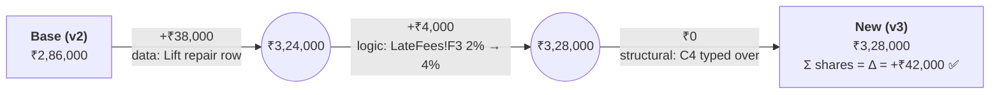
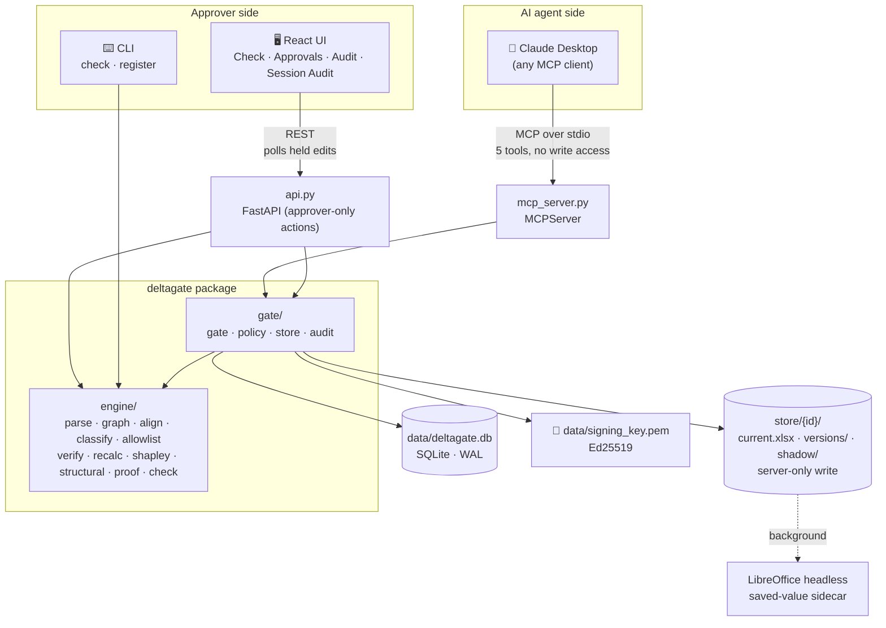
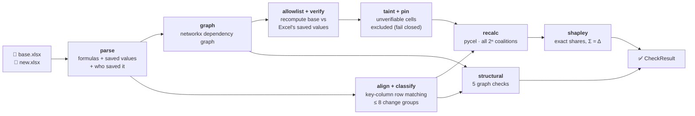
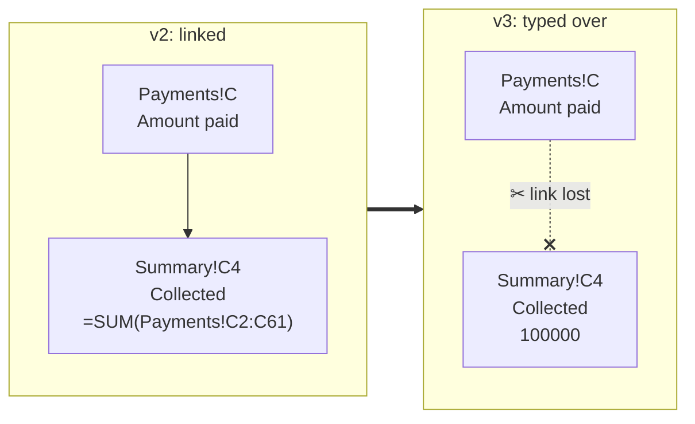
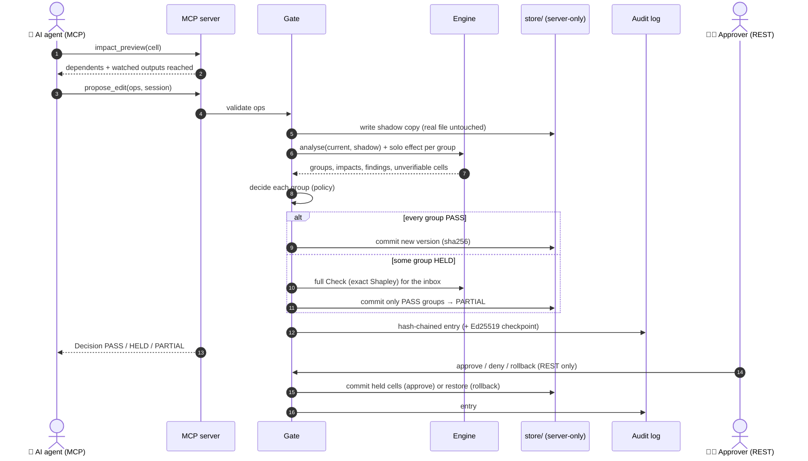
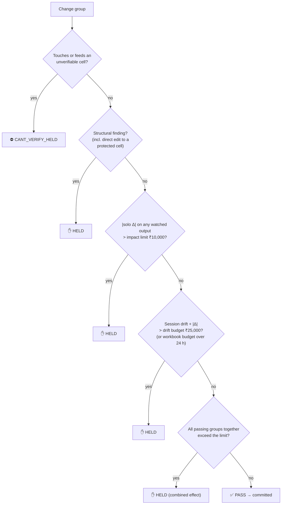
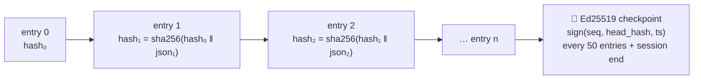

<div align="center">


# Delta Gate

### An independent check for AI spreadsheet edits

**Know exactly what every edit did to your numbers before it lands, down to the rupee and the cause.**

[](#)
<br/>
[](backend/pyproject.toml)
[](backend/deltagate/mcp_server.py)
[](backend/deltagate/api.py)
[](frontend/)
[](backend/tests/)
[](backend/deltagate/gate/audit.py)

[The problem](#-the-problem) ·
[What it does](#-what-delta-gate-does) ·
[Demo](#-the-result-in-one-screen) ·
[How it works](#-how-it-works) ·
[The maths](#-the-maths-exact-attribution-with-shapley-values) ·
[Gate](#-the-gate-the-agent-never-holds-the-pen) ·
[Quick start](#-quick-start) ·
[Limits](#-honest-limits)

</div>

---

> **Diffing tools are free. Approval gates are standard. Delta Gate is the part in between.**
> It recalculates what an edit actually does, splits the change in every watched number into **exact ₹ per cause**, catches **broken links even when the total doesn't move**, holds AI edits that cross policy limits, and when it can't verify something it says so and **holds. It never guesses.**

---

## 🧭 The problem

- **84% of spreadsheets contain a material error** ([Panko, via *The New Republic*](https://newrepublic.com/article/112951/kenneth-rogoff-carmen-reinhart-and-world-excel-error-research)).
- AI agents now edit them too. Microsoft's own Excel agent gets **57.2%** of SpreadsheetBench's 912 tasks right ([Microsoft, 2025](https://techcommunity.microsoft.com/blog/excelblog/building-agent-mode-in-excel/4457320)).
- When a total moves, nobody can answer **"which edit caused how much of this?"** and nothing checks what an AI edit does to the numbers **before** it lands.

Software has diffs, tests and `terraform plan`. Spreadsheets have nothing equivalent. **Delta Gate is a `plan` + `review` step for spreadsheets, with an MCP gate in front of the AI agent.**

**Demo customer:** a housing-society treasurer and the society's maintenance-dues workbook (60 flats).

---

## ✨ What Delta Gate does

| Mode | You give it | You get |
|---|---|---|
| 🔍 **Check** | Two versions of a workbook | The change in every watched output, **split exactly by cause** in ₹ (Shapley shares that add up to Δ); data vs logic vs structural changes; structural warnings; coverage %; a **proof workbook** to open in Excel yourself |
| 🛡️ **Gate** | An AI agent's edit, made through our **MCP server** (its only write path) | **PASS**, **HELD** (with reasons and ₹ impact) or **CAN'T VERIFY → HELD**, decided per change group; every decision written to a **hash-chained, Ed25519-signed** audit log |
| 🕵️ **Session Audit** | A snapshot taken before an in-Excel AI session, and the file afterwards | A full Check of everything that session changed: our honest answer for agents running *inside* Excel that nobody can intercept |

### Five rules we never break

| # | Rule | How it is enforced |
|---|---|---|
| 1 | **Every number comes from the engine** | The UI only formats engine output. `null` is shown as *unknown*, never as 0. Sentences are templates |
| 2 | **Fail closed** | A cell that depends on an unsupported or volatile function, a macro or an external link is *unverifiable*: excluded from attribution, reported in `delta_unverified`, and any gated edit touching it is **held** |
| 3 | **The agent never holds the pen** | MCP exposes 5 read/propose tools. `approve`, `deny`, `rollback` are REST-only and never MCP tools. Only the server writes `store/` |
| 4 | **Honest labels** | The banner names the app that saved the cached values (`docProps/app.xml`). It never says Excel when it wasn't Excel |
| 5 | **Tamper-evident, not "tamper-proof"** | SHA-256 hash chain plus Ed25519 checkpoints, verifiable on demand |

---

## 📊 The result in one screen

`dues_v2.xlsx` → `dues_v3_REAL.xlsx`, with three planted changes. This is real output from the CLI on this repo:

```text
$ uv run python -m deltagate.cli check ../golden/dues_v2.xlsx ../golden/dues_v3_REAL.xlsx

Delta Gate check: dues_v2.xlsx -> dues_v3_REAL.xlsx
Verified against Excel's saved values: 307 / 307 formula cells match
Coverage: 100.0%

Summary!C6  Total pending dues: ₹2,86,000 -> ₹3,28,000   change +₹42,000   (verified +₹42,000, unverified ₹0)
  g1  data        New row in Expenses: Lift repair              solo   +₹38,000  share   +₹38,000  interaction ₹0
  g2  logic       Formula changed: LateFees!F3                  solo    +₹4,000  share    +₹4,000  interaction ₹0
  g3  structural  Formula replaced by a value: Summary!C4       solo         ₹0  share         ₹0  interaction ₹0

Structural findings: 4
  protected_formula_edit    LateFees!F3     Protected cell LateFees!F3 was edited directly (formula changed)
  typed_over_formula        Summary!C4      Summary!C4 held the formula =SUM(Payments!C2:C61) and now holds a typed value
  protected_formula_edit    Summary!C4      Protected cell Summary!C4 was edited directly (formula replaced by a value)
  lost_link                 Summary!C4      Collected no longer depends on Payments!C (Amount paid)

Check ran in 0.88 s
```



**What a plain diff misses:** `Summary!C4` (*Collected*) still shows ₹1,00,000, so the total looks fine. But its formula was typed over with its own value, so it **no longer follows payments**. Delta Gate flags it as `typed_over_formula` + `lost_link`: *"the number looks right, but the sheet is broken."*

### Fail closed, live

Drop in a file that uses `XLOOKUP` (not on our verified list):

```text
Summary!C6  Total pending dues: ₹2,86,000 -> ₹3,28,000   change +₹42,000   (verified +₹38,000, unverified +₹4,000)
Coverage: 59.6%
  XLOOKUP: LateFees!C2, LateFees!C3, LateFees!C4, … (60 cells)
```

> *"I can verify ₹38,000 of the ₹42,000 change. The rest depends on 60 cells using XLOOKUP, listed. Held."*

---

## 🏗️ How it works

### System architecture



The MCP server and the FastAPI app are **separate processes** that share the `deltagate` package, a SQLite database in WAL mode, and the `store/` folder.

### The Check pipeline



| Step | Module | What it does |
|---|---|---|
| Parse | [`parse.py`](backend/deltagate/engine/parse.py) | Loads the workbook twice: formulas, and Excel's cached values. Reads `docProps/app.xml` to know **who** saved it. Flags macros, pivots, array formulas |
| Graph | [`graph.py`](backend/deltagate/engine/graph.py) | Cell and range nodes, precedent → dependent edges; input regions for lost-link; impact for `impact_preview` |
| Align + classify | [`align.py`](backend/deltagate/engine/align.py), [`classify.py`](backend/deltagate/engine/classify.py) | Matches rows on a key column (`Flat No`, `Invoice No`, `ID`…), LCS fallback. Groups raw diffs into ≤ 8 **data / logic / structural** groups; renamed sheets travel with their formulas |
| Verify | [`allowlist.py`](backend/deltagate/engine/allowlist.py), [`verify.py`](backend/deltagate/engine/verify.py) | Recomputes the **base** with our engine and compares every formula cell to the saved value (rel. tol. 1e-9). Mismatches become unverifiable |
| Taint + pin | [`check.py`](backend/deltagate/engine/check.py) | Unverifiable roots and everything downstream are tainted, then **pinned at their saved base value**, so `delta_verified` only moves through verified cells |
| Recalc | [`recalc.py`](backend/deltagate/engine/recalc.py) | One compiled pycel model per subset of formula groups; value groups toggled with `set_value`. 256 coalitions in ~1.1 s instead of ~62 s |
| Shapley | [`shapley.py`](backend/deltagate/engine/shapley.py) | Exact Shapley over ≤ 8 groups. Pure function |
| Structural | [`structural.py`](backend/deltagate/engine/structural.py) | Five checks on the graph, not on numbers |
| Proof | [`proof.py`](backend/deltagate/engine/proof.py) | Base + one change, formulas intact, `fullCalcOnLoad = True`: open it in Excel and **Excel** computes the effect |

---

## 🧮 The maths: exact attribution with Shapley values

Let $F$ be a watched output (e.g. *Total pending dues*), $B$ the base workbook and $G = \{g_1, \dots, g_n\}$ the change groups ($n \le 8$).

**Coalition value**: apply only the groups in $S$:

$$v(S) = F(B \oplus S) - F(B), \qquad v(\varnothing) = 0, \qquad v(G) = \Delta$$

**Shapley share** of group $g$, its fair share averaged over every order the changes could have been applied in:

$$\varphi(g) = \sum_{S \subseteq G \setminus \{g\}} \frac{|S|!\,(n-|S|-1)!}{n!}\,\bigl[v(S \cup \{g\}) - v(S)\bigr]$$

| Quantity | Formula | Meaning |
|---|---|---|
| **Solo effect** | $v(\{g\})$ | What the change does on its own (what *Prove it* replays in Excel) |
| **Shapley share** | $\varphi(g)$ | Its fair share of the total |
| **Interaction** | $\varphi(g) - v(\{g\})$ | The part that exists only because it combines with other changes |

**Guarantee:** $\sum_g \varphi(g) = \Delta$ exactly (Shapley efficiency), so **the waterfall bars always add up to the real change.** Unverified change is a separate bucket, $\Delta_{\text{unverified}} = \Delta_{\text{observed}} - \Delta_{\text{verified}}$, and is never blended into the shares.

<details>
<summary><b>Worked example (a unit test in this repo)</b></summary>

`dues = rate × area × (1 + late%)`, area = 1,000. Base: rate 3.0, late 2% → ₹3,060. New: rate 3.2, late 5% → ₹3,360. **Δ = ₹300.**

| Group | Solo | **Shapley share** | Interaction |
|---|---:|---:|---:|
| Rate 3.0 → 3.2 | ₹204 | **₹207** | +₹3 |
| Late fee 2% → 5% | ₹90 | **₹93** | +₹3 |
| **Total** | ₹294 ❌ ≠ Δ | **₹300 = Δ ✅** | ₹6 |

Solo effects alone don't add up to the total. Shapley shares do. That is why we use them.

Property tests ([hypothesis](backend/tests/test_shapley.py)) check on random games that $\sum \varphi = \Delta$ within 1e-9, $v(\varnothing) = 0$, and identical groups get identical shares.
</details>

---

## 🧱 Structural checks: breakage the total can't show

These run on the dependency graph, so they fire **even when Δ = 0**.

| Finding | Fires when | Example |
|---|---|---|
| `typed_over_formula` | A formula cell now holds a constant | Someone typed ₹1,00,000 over `=SUM(Payments!C2:C61)` |
| `shortened_range` | A range got smaller, or doesn't cover a newly appended row | `SUM(C2:C61)` → `SUM(C2:C60)`: flat 60 is missing |
| `protected_formula_edit` | A protected cell was edited directly | `LateFees!F3` rate formula changed |
| `rows_deleted_in_range` | Rows removed inside a range formulas use | Deleting a payments row mid-table |
| `lost_link` | A watched output **no longer depends** on an input region (sheet + column header) | *"Collected no longer depends on Payments!C (Amount paid)"* |



---

## 🛡️ The gate: the agent never holds the pen

### Trust boundary

| Surface | Who uses it | Can do |
|---|---|---|
| **MCP** (stdio) | The AI agent | `read_range`, `impact_preview`, `explain_delta`, `propose_edit`, `get_decision` |
| **REST** | The human approver (UI) | Everything above **plus** `approve`, `deny`, `rollback` |
| **Filesystem** `store/` | Only the server process | Writes every committed version |

The agent has **no file tool and no Excel tool**. Its only way to change a workbook is `propose_edit`. Anything written outside that path (a human in Excel, an in-Excel AI) is **detected** on the next read as an *unmanaged change* and checked automatically.

### What happens on `propose_edit`



### Decision rules, per change group



The **drift budget** stops salami-slicing: ten ₹3,000 edits each pass the ₹10,000 limit, but the 9th would take the session to ₹27,000 > ₹25,000, so it is held. A **workbook-wide** budget over a rolling 24 h window means opening a new session can't reset it.

Policy is plain YAML ([`policy.yaml`](policy.yaml)):

```yaml
watched_outputs:
  - {cell: "Summary!C6", label: "Total pending dues"}
  - {cell: "Summary!C4", label: "Collected"}
impact_limit_abs: 10000        # per output, per group
drift_budget: 25000            # per session, sum of |Δ| over PASSed groups
workbook_drift_budget: 50000   # all sessions on one workbook, rolling window
drift_window_hours: 24
protected: ["LateFees!F3", "Summary!C4", "Summary!C6"]
```

---

## 🔏 Tamper-evident audit log



- Every gate decision, approval, denial, rollback and unmanaged change is an entry.
- `GET /api/audit/verify` re-walks the chain and checks every signature. A tampered row, a tampered signature, or a log truncated past a checkpoint all fail.
- The signing key (`data/signing_key.pem`) is generated on first run and gitignored.

---

## ✅ Verification: why this isn't "proof by our own engine"

1. **Checked against the saved values, every time.** An `.xlsx` saved by Excel contains Excel's own result for every formula. Before trusting anything, we recompute the **base** and compare cell by cell: *"Verified against Excel's saved values: 307 / 307 formula cells match."*
2. **Honest labels.** We read who saved the file:

   | `docProps/app.xml` says | Banner |
   |---|---|
   | `Microsoft Excel` | Verified against **Excel's** saved values |
   | `LibreOffice/…` | Verified against **LibreOffice's** saved values |
   | anything else / no cached values | **Not verifiable** against saved values |

   Server commits are written by openpyxl (no cached values), so they start as `pending`. A background LibreOffice worker adds a sidecar with saved values, and the version is relabelled `LibreOffice` (or `none` on failure). **It is never labelled Excel.**
3. **Prove it in Excel.** The proof workbook contains the base plus **one** change, formulas intact, flagged `fullCalcOnLoad`. Open it in Excel and Excel itself shows the solo effect.

### Published function allowlist

Functions are enabled only after passing our tests against known answers (pycel 1.0b30).

| Status | Functions |
|---|---|
| ✅ **Verified** | `SUM` `MIN` `MAX` `AVERAGE` `COUNT` `IF` `AND` `OR` `NOT` `ABS` `INT` `MOD` `SUMIF` `SUMIFS` `COUNTIF` `SUMPRODUCT` `IFERROR` `VLOOKUP` `INDEX` `MATCH` `LEN` `ROUNDUP` `TRUE` `FALSE` |
| ⚠️ **Fidelity risk** | `ROUND`: `ROUND(7.5*1.234, 2)` gives 9.25 in pycel (binary 9.2549…), Excel gives 9.26. Unverifiable until an Excel-compatible override passes |
| ❌ **Not implemented** | `COUNTA`, `XLOOKUP` |
| 🚫 **Unverifiable by design** | `NOW` `TODAY` `RAND` (volatile), `OFFSET` `INDIRECT` (runtime references), macros, external links, pivots, dynamic arrays, `LET` |

---

## ⚡ Performance (measured)

| What | Result | Budget |
|---|---|---|
| Check `dues_v2` → `dues_v3_REAL` | p50 **2.2 s**, p95 2.6 s (0.9 s warm CLI run) | 10 s |
| Check `dues_v2` → `judge_xlookup` | p50 **0.9 s**, p95 1.3 s | 10 s |
| Gate decision (`propose_edit`, 11 Act 2 edits) | p50 **0.77 s**, p95 2.1 s | 3 s |
| 256 Shapley coalitions | **~1.1 s** (4 compiles + `set_value`) vs ~62 s naive recompile | — |
| LibreOffice saved-value sidecar | p50 1.8 s, run in the **background** | off the commit path |

---

## 🧪 Testing

```text
$ uv run pytest -q
181 passed, 6 skipped in 117.95s
```

| Suite | Covers |
|---|---|
| [`test_shapley.py`](backend/tests/test_shapley.py) | Hypothesis property tests (Σφ = Δ, v(∅) = 0, symmetry) + the worked example |
| [`test_golden.py`](backend/tests/test_golden.py), [`test_check.py`](backend/tests/test_check.py) | Exact demo numbers: ₹2,86,000 → ₹3,28,000, +₹42,000 = ₹38,000 + ₹4,000, lost link on C4 only, 307/307 vs Excel, XLOOKUP 38,000 verified + 4,000 unverified |
| [`test_gate.py`](backend/tests/test_gate.py) | Act 2: Session A `PARTIAL`, Session B 9th edit held by drift, `CANT_VERIFY_HELD`, joint check, unmanaged changes, approve / deny / rollback |
| [`test_audit.py`](backend/tests/test_audit.py) | Hash chain, Ed25519 checkpoints, tamper and truncation detection |
| [`test_mcp.py`](backend/tests/test_mcp.py) | Exactly 5 MCP tools; no approve / deny / rollback on the agent surface |
| [`test_messy.py`](backend/tests/test_messy.py) | "Judge's own file" drill: merged headers, blank rows, no key, `.xlsm` macros, renamed sheets |
| [`test_api*.py`](backend/tests/), [`test_session_audit.py`](backend/tests/test_session_audit.py) | REST endpoints and Session Audit |

Golden workbooks are generated with openpyxl, recalculated by LibreOffice headless, then **re-saved by real Excel over COM** so the "Verified against Excel" banner is literally true. A headless end-to-end script, [`scripts/demo_check.py`](scripts/demo_check.py), asserts every on-stage number and the latency budgets.

---

## 🚀 Quick start

**Prerequisites:** Python 3.12 + [uv](https://docs.astral.sh/uv/), Node 20+, LibreOffice (optional, for saved-value sidecars).

```powershell
# 1. Backend: install, test, run a Check from the terminal
cd backend
uv sync
uv run pytest -q
uv run python -m deltagate.cli check ..\golden\dues_v2.xlsx ..\golden\dues_v3_REAL.xlsx
```

```powershell
# 2. Reset the demo store (registers dues_v2.xlsx as "dues") and start the REST API
powershell -File scripts\demo_reset.ps1
cd backend
uv run uvicorn deltagate.api:app --port 8000
```

```powershell
# 3. Frontend
cd frontend
npm install
npm run dev        # http://localhost:5173
```

### Connect an AI agent over MCP

Add to Claude Desktop's `claude_desktop_config.json` (any MCP client works the same way):

```json
{
  "mcpServers": {
    "delta-gate": {
      "command": "uv",
      "args": ["--directory", "/ABS/PATH/Delta_Gate/backend", "run", "python", "-m", "deltagate.mcp_server"]
    }
  }
}
```

Restart the client and look for **"Connected to delta-gate (5 tools)"**. Then try:

> *"Update late fees for overdue flats and tidy up the Summary sheet."*

Payment edits pass, the protected late-fee formula is **held**, and the edit appears in the Approvals tab for a human to approve or deny.

---

## 🔌 Interfaces

<details>
<summary><b>MCP tools (agent surface)</b></summary>

| Tool | Purpose |
|---|---|
| `read_range(workbook_id, range)` | Values and formulas (saved value of a formula, else engine value where allowed, else null) |
| `impact_preview(workbook_id, cell)` | Dependents of a cell and which watched outputs it reaches, before proposing |
| `explain_delta(base_version, new_version)` | A full Check between two versions |
| `propose_edit(workbook_id, ops, session_id)` | **The only write path.** Returns a Decision |
| `get_decision(edit_id)` | The current Decision of an edit (e.g. after a human approves) |

Edit ops:

```json
{"op": "set_value",   "cell": "Payments!C5", "value": 2500}
{"op": "set_formula", "cell": "LateFees!F3", "formula": "=F2*0.04"}
{"op": "append_row",  "sheet": "Expenses",   "values": ["Lift repair", 38000]}
```
</details>

<details>
<summary><b>REST API (approver + UI surface)</b></summary>

| Method | Route | Purpose |
|---|---|---|
| `POST` | `/api/checks` | Upload two files, run a Check |
| `GET` | `/api/checks/{id}` | Fetch a Check result |
| `POST` | `/api/checks/{id}/proof/{group_id}` | Download the proof workbook for one change |
| `GET` | `/api/exports/{check_id}.csv` | Change-log export |
| `GET` | `/api/edits?status=held` | Approvals inbox |
| `POST` | `/api/edits/{id}/approve` · `/deny` | Approver decisions (**never** on MCP) |
| `POST` | `/api/workbooks/{id}/rollback` | Restore the previous managed version |
| `GET` | `/api/workbooks` · `/api/policy` | Managed workbooks and active policy |
| `GET` | `/api/audit` · `/api/audit/verify` | Audit log and chain + signature verification |
| `POST` | `/api/session-audit/snapshot` · `/complete` | Session Audit |
</details>

<details>
<summary><b>CheckResult contract (abridged)</b></summary>

```json
{
  "mode": "check",
  "verification": {"saved_by": "Microsoft Excel", "formula_cells": 307, "matched": 307, "mismatched": []},
  "groups": [{"group_id": "g1", "label": "New row in Expenses: Lift repair", "type": "data", "cells": ["Expenses!A12", "Expenses!B12"]}],
  "outputs": [{
    "cell": "Summary!C6", "label": "Total pending dues",
    "base": 286000, "new": 328000,
    "delta_observed": 42000, "delta_verified": 42000, "delta_unverified": 0,
    "attribution": [{"group_id": "g1", "solo": 38000, "share": 38000, "interaction": 0}]
  }],
  "structural": [{"kind": "lost_link", "cell": "Summary!C4", "message": "Collected no longer depends on Payments!C (Amount paid)"}],
  "unverifiable": [],
  "coverage": 1.0
}
```

`base`, `new`, `delta_observed` and `delta_unverified` may be `null`, meaning *unknown*: the engine refuses to compute what it can't verify. Full types live in [`models.py`](backend/deltagate/models.py).
</details>

---

## 🗂️ Repository layout

```text
backend/deltagate/
  engine/        parse · graph · align · classify · allowlist · verify · recalc · shapley · structural · proof · check
  gate/          gate (propose → shadow → decide → commit) · policy · store · audit
  api.py         FastAPI: approver + UI surface
  mcp_server.py  MCPServer (stdio): agent surface, 5 tools
  cli.py         check · register
  models.py      pydantic contracts, the single source of types
backend/tests/   181 tests (pytest + hypothesis)
frontend/src/    React 19 + Vite + TypeScript + Tailwind v4, ECharts waterfall, React Flow lost-link graph
golden/          Excel-saved demo workbooks + generators (openpyxl → LibreOffice → Excel COM)
scripts/         demo_reset.ps1 · demo_check.py (headless end-to-end) · dump_fixtures.py · make_messy.py
policy.yaml      demo policy
docs/            spec, build log, project overview, demo runbook
```

---

## ⚠️ Honest limits

We would rather tell you than have you find out:

- **In-Excel agents can't be blocked**, only audited afterwards (Session Audit). We only claim to *gate* writes that go through our MCP server.
- **Server commits are written by openpyxl**: charts, images and pivot caches are lost on the first gated commit. The demo workbooks have none.
- **For ~2 s after a commit** (until the LibreOffice sidecar lands) a Check reports "Not verifiable against saved values".
- **Lost link is the hackathon version:** watched outputs only, same-workbook column regions, no named ranges.
- **More than 3 formula groups** are merged to cap compiles at 8, so their shares are reported together.
- **Renamed sheets** are detected on an exact content match only.

---

## 🛣️ Roadmap

| Stage | Scope |
|---|---|
| **Now (hackathon)** | Check · Gate over MCP · Session Audit · exact Shapley · 5 structural checks · signed audit log · published allowlist |
| **Next** | Excel-compatible `ROUND`, more golden-tested functions (`XLOOKUP` via the `formulas` engine), automatic watched-output detection, society pilots |
| **Then** | Full lost link (named ranges, cross-sheet tables, partial loss), invariants ("sum of flat dues = ledger total"), CA-firm team policies |
| **Later** | SDK for spreadsheet-agent builders, approver-held signing keys, RFC 3161 timestamps |

---

## 👥 Team

Built in 24 hours for **wHACKiest 2026 · Track 1: Make MCP Matter**.

| Role | Owner | Area |
|---|---|---|
| P1 | Rudraditya | MCP server, gate, store, REST API, database |
| P2 | Nikita | Graph and structural checks, Approvals and Audit UI |
| P3 | Hemanth | Recalculation, verification, Shapley, demo harness |
| P4 | Nitika | App shell, Home and Check UI, golden workbooks, demo |

<div align="center">

**Delta Gate: proof, not a guess.**

</div>
