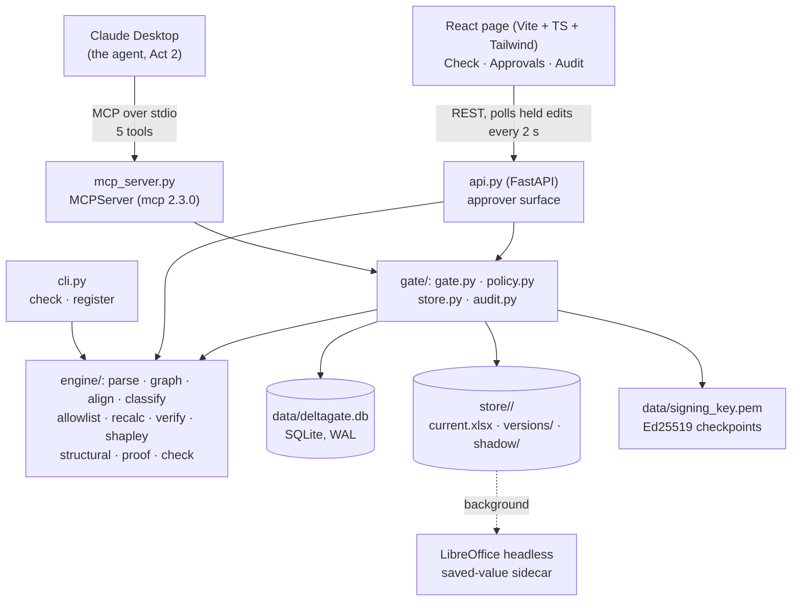
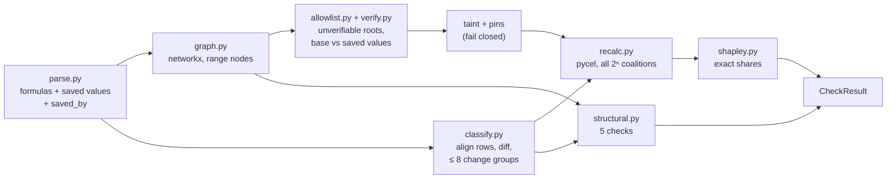

# Delta Gate: project overview (architecture, progress, split)

**One file with everything: what we are building, how it is built, where it stands, and who does what next.**
State as of **23 Nov 2026, evening** (`main` at the SPLIT v2 merge, PR #13). wHACKiest 2026, Track 1: *Make MCP Matter*.

**Sources, if you need more detail:**
- `CLAUDE.md`: the build rules. They win on any conflict.
- `docs/delta-gate-final.md`: the product spec.
- `docs/PROGRESS.md`: the build log.
- `docs/SPLIT.md`: the full split with every deadline.

**Status markers used below:**
- ✅ on `main`
- 🔀 in an open PR (number given)
- ⬜ not started

---

## Contents
1. [What Delta Gate is](#1-what-delta-gate-is)
2. [Architecture](#2-architecture)
3. [The engine: how a Check works](#3-the-engine-how-a-check-works)
4. [The gate, the store and the audit log](#4-the-gate-the-store-and-the-audit-log)
5. [Surfaces: MCP, REST, CLI, UI](#5-surfaces-mcp-rest-cli-ui)
6. [Contracts](#6-contracts)
7. [Demo data and the 3-minute demo](#7-demo-data-and-the-3-minute-demo)
8. [Progress](#8-progress)
9. [Known issues and limits](#9-known-issues-and-limits)
10. [The split: two teams](#10-the-split-two-teams)
11. [Run commands](#11-run-commands)

---

## 1. What Delta Gate is

**An independent check for AI spreadsheet edits.** When an AI agent (or anyone) edits a workbook, Delta Gate:
1. recalculates what every edit does;
2. splits the change in each watched output into **exact ₹ per cause** (Shapley shares that add up to Δ);
3. flags **structural breakage** even when the total does not move (e.g. a formula typed over with its own value);
4. **holds** AI-agent edits that cross policy limits, for a human to approve;
5. says **"can't verify"** and holds when it cannot check something. It never guesses.

**Problem:** 84% of spreadsheets contain a material error (Panko). AI agents now edit them, and nothing checks what an edit does to the numbers before it lands, or which edit caused how much of a change.

**Who it is for:**
- **Demo story:** a housing-society treasurer and the maintenance-dues sheet.
- **Real users:** finance and model reviewers, CA reviewers working on Excel working papers, and developers building spreadsheet agents over MCP.

### Three modes
| Mode | Input | Output |
|---|---|---|
| **Check** | two versions of a workbook | change per watched output, split exactly by cause; data vs logic vs structural; structural warnings; coverage %; a proof workbook to open in Excel |
| **Gate** | an AI agent's edit through our MCP server (its only write path) | PASS / HELD / CAN'T VERIFY → HELD, per change group; every decision in a signed, tamper-evident log |
| **Session Audit** | a snapshot taken before an in-Excel AI session + the file after | a Check of everything that session changed (our answer for agents we cannot block) |

### Rules we never break (`CLAUDE.md` §2)
1. **Every number shown comes from the engine.**
   - The LLM is optional and writes words only.
   - Template sentences are the default.
2. **Fail closed.** A cell that depends on an unsupported or volatile function, a macro or an external link is **unverifiable**:
   - it is left out of attribution;
   - it is reported in `delta_unverified`;
   - any gated edit that touches it is held.
3. **The agent never holds the pen.**
   - MCP exposes only `read_range`, `impact_preview`, `explain_delta`, `propose_edit` and `get_decision`.
   - `approve`, `deny` and `rollback` are REST-only and approver-only.
   - Only the server writes files in `store/`.
4. **Honest labels.** The banner names the app that saved the cached values (`docProps/app.xml`):
   - Microsoft Excel → "Verified against Excel's saved values";
   - LibreOffice → "Verified against LibreOffice's saved values";
   - anything else → "Not verifiable against saved values".
   - It never claims Excel when the file wasn't saved by Excel.
5. **Out of scope:** WhatsApp, S3, Redis, auth, Postgres, Docker, cloud deploy, an Excel add-in, proxy mode, a gateway endpoint.

---

## 2. Architecture

### 2.1 Processes and data



- **The MCP server and the FastAPI app are separate processes.** They share three things:
  - the `deltagate` Python package;
  - `data/deltagate.db` (SQLite in WAL mode, so both can use it at once);
  - the `store/` folder.
- **Claude Desktop starts two MCP server processes** for one config entry. Both share the database safely.
- **Runtime paths** come from `DELTAGATE_HOME` (default: the repo root, i.e. `data/` and `store/`). `DELTAGATE_SOFFICE=off` turns LibreOffice off.

### 2.2 Stack (pinned; ask before adding dependencies)
- **Backend:**
  - Python 3.12 + uv;
  - fastapi + uvicorn;
  - `mcp[cli]` 2.x: `MCPServer`, stdio (`FastMCP` is the 1.x name and no longer imports);
  - openpyxl, networkx, **pycel 1.0b30** (primary engine), `formulas` (fallback, not wired in);
  - cryptography (Ed25519), pydantic v2, sqlite3 (WAL);
  - pytest + hypothesis.
- **Frontend:**
  - React 19, Vite 8, TypeScript;
  - Tailwind v4 (`@tailwindcss/vite`);
  - planned: `echarts-for-react` (waterfall), `@xyflow/react` (lost-link graph), `@tanstack/react-query`.
- **Tools:**
  - LibreOffice headless (cached values for generated files, and the commit sidecar);
  - Excel over COM (`golden/excel_resave.ps1`), so golden files are honestly "saved by Excel".

### 2.3 Repository layout
```
CLAUDE.md                     build rules (read first)
policy.yaml                   demo policy (watched outputs, limits, protected cells)
docs/
  delta-gate-final.md         product spec (read-only)
  PROGRESS.md                 build log: done / decisions / known issues
  SPLIT.md                    who does what (v2, two teams)
  PROMPTS.md                  phase prompts
  PROJECT_OVERVIEW.md         this file
golden/
  make_golden.py, recalc.sh, excel_resave.ps1, make_truefalse.py
  dues_v2.xlsx, dues_v3_REAL.xlsx, judge_xlookup.xlsx, truefalse.xlsx   (Excel-saved, frozen)
  drift_steps.json            the Act 2 gate script
  messy_*_v2/v3 + messy_ops.json                                          🔀 #11
backend/deltagate/
  config.py  models.py  db.py  cli.py  mcp_server.py                      ✅
  api.py                                                                  ⬜
  session_audit.py                                                        🔀 #6
  engine/  parse allowlist graph align classify recalc verify shapley structural proof check   ✅
  gate/    store policy gate audit                                        ✅
backend/tests/                ~95 tests on main; 139 + 5 skipped with all open PRs merged
frontend/src/
  types.ts  format.ts  tabs/Approvals/  components/StructuralPanel.tsx    🔀 #8, #9
  fixtures/*.json             real engine output                           🔀 #7
scripts/
  demo_reset.ps1                                                          ✅
  dump_fixtures.py                                                        🔀 #7
  make_messy.py                                                           🔀 #11
  demo_check.py                                                           ⬜
spikes/                       throwaway experiments (pycel behaviour, timing)
```

---

## 3. The engine: how a Check works

`check(base, new, policy) = result(analyse(base, new, policy))`. The gate calls `analyse()` and evaluates only the coalitions it needs; the full Check builds all of them.



| Step | Module | What it does |
|---|---|---|
| Parse | `parse.py` | Loads the workbook twice: formulas, and the saved (cached) values. Reads the `Application` string from `docProps/app.xml` and labels `saved_by`: exactly "Microsoft Excel", or the "LibreOffice/" prefix, else `none`. No cached values at all → `none`. Flags workbook-level blockers (macros/VBA, pivot tables) and array formulas |
| Graph | `graph.py` | Dependency graph: cell and range nodes, edges from precedent to dependent. Also `input_regions` (for lost link), `impact` (for `impact_preview`), and `column_path` (lost-link paths, 🔀 #10) |
| Align + classify | `align.py`, `classify.py` | Aligns rows by a key column (`Flat No`, `Flat`, `Invoice No`, `ID`), else by LCS over row fingerprints. Groups raw differences by (sheet, column, type) into **data / logic / structural** groups; more than 8 groups are merged (sheet + type, then type). Formula groups are capped at 3, so at most 8 compiles (🔀 #6). A renamed or new sheet and the formulas that use it form one group (🔀 #11, #12) |
| Unverifiable | `allowlist.py`, `verify.py` | Roots: a function not on the allowlist, an error literal, a named range / table / external reference, an array formula, a blocker. Then the base is recomputed by the engine and compared with its saved values (rel tol 1e-9); mismatches become roots too |
| Taint + pins | `check.py` | Tainted = roots plus everything downstream (on base ∪ new). For a tainted watched output, every tainted cell upstream of it is **pinned at its saved base value** in all coalitions, so `delta_verified` only moves through verified cells. A group that reaches an output only through pinned cells is left out of that output's attribution (🔀 #12) |
| Recalc | `recalc.py` | pycel, always compiled from a formulas-only openpyxl workbook; compiling from a filename would just return the cached values (circular). One compiled model per subset of formula groups; value groups toggled with `set_value`. Typed-over formulas are always formula groups |
| Shapley | `shapley.py` | Exact Shapley over ≤ 8 groups (≤ 256 coalitions). Pure function |
| Structural | `structural.py` | Five checks, see below |
| Proof | `proof.py` | The base with one group applied, formulas intact, `fullCalcOnLoad = True`. Open it in Excel to see the solo effect computed by Excel |

### 3.1 The maths
- **Coalition value:** `v(S) = F(base with only the groups in S applied) − F(base)`, so `v(∅) = 0` and `v(all groups) = Δ`.
- **Solo effect:** `v({g})`, what the change does on its own. "Prove it" replays this.
- **Shapley share:** φ(g), the average marginal effect of g over every order of applying the changes. **The shares add up exactly to Δ.**
- **Interaction:** `φ(g) − solo(g)`.
- **Unverified is a separate bucket, never mixed into the shares:** `delta_unverified = delta_observed − delta_verified`.
- **Worked example (unit test):** `dues = rate × area × (1 + late%)`, area 1,000; rate 3.0 → 3.2 and late fee 2% → 5% give Δ ₹300 = ₹207 + ₹93 (solo ₹204 and ₹90, interaction +₹3 each).

### 3.2 Structural checks (`StructuralFinding.kind`)
| Kind | Fires when |
|---|---|
| `typed_over_formula` | a cell that held a formula now holds a constant (or nothing) |
| `shortened_range` | a formula's range got smaller, or a range does not cover a newly appended row |
| `protected_formula_edit` | a cell in `policy.protected` was edited directly (value or formula) |
| `rows_deleted_in_range` | rows were removed inside a range that formulas use |
| `lost_link` | a watched output no longer depends on an input region (sheet + column header). Same workbook only, no named ranges. Regions are mapped through renamed sheets (🔀 #11). With #10, it also carries `region`, `path_before` and `kept` (other watched outputs that still reach the region) |

### 3.3 Supported functions (allowlist)
- ✅ **Supported:** SUM MIN MAX AVERAGE COUNT IF AND OR NOT ABS INT MOD SUMIF SUMIFS COUNTIF SUMPRODUCT IFERROR VLOOKUP INDEX MATCH LEN ROUNDUP, plus TRUE / FALSE (golden test `truefalse.xlsx`: 24 cells, all match Excel).
- ⚠️ **ROUND:** unverifiable until an Excel-compatible override passes a golden test (`ROUND(7.5*1.234,2)` must give 9.26).
- ❌ **Not supported:** COUNTA and XLOOKUP (not in pycel).
- 🚫 **Always unverifiable:** NOW TODAY RAND OFFSET INDIRECT, macros, external links, pivot tables, dynamic arrays (SORT, FILTER, UNIQUE…), LET.

---

## 4. The gate, the store and the audit log

### 4.1 `propose_edit` (the agent's only write path)
1. **Validate the ops** at the boundary:
   - a cell is written as `Sheet!A1`, and the sheet must exist;
   - `set_formula` must start with `=`;
   - a value (also inside `append_row`) must not.
2. **Shadow copy:** apply the ops to a copy (`store/<id>/shadow/<edit>.xlsx`). The real file is not touched.
3. **`analyse(current, shadow)`**, then the **solo effect** of each group (2 evaluations per group, using cached compiled models).
4. **Per-group decision** (`gate/policy.py::decide`, pure; rules checked in this order):
   1. **can't verify:** the group edits or feeds an unverifiable cell → `CANT_VERIFY_HELD`, with no impact numbers;
   2. **structural:** any structural finding on the group's cells, including a direct edit to a protected cell → `HELD`;
   3. **impact limit:** |solo effect| on a watched output > `impact_limit_abs` (₹10,000) → `HELD`;
   4. **drift budget:** session drift + the group's largest |solo| > `drift_budget` (₹25,000) → `HELD`;
   5. **combined effect:** all passing groups applied together exceed the limit → all of them `HELD`.
5. **If anything is held,** build the full Check (exact Shapley) for the approvals inbox.
6. **Commit the PASS groups** (their cells copied from the shadow onto the base). The edit's status is `PASS`, `HELD` or `PARTIAL`.
7. **Write an audit entry,** with timings printed on stderr.

The approver then decides through REST:
- **approve:** commits the held cells; refused with `Conflict` if a held cell changed meanwhile;
- **deny:** the file is untouched;
- **rollback:** restores the previous managed version as a new version.

### 4.2 Store (`gate/store.py`)
- **`register`:** takes a workbook into `store/<id>/`: `current.xlsx` plus immutable `versions/<sha>.xlsx`.
- **Unmanaged changes:** if `current.xlsx` no longer matches the last committed hash (someone edited it in Excel), the next read records it as an `unmanaged` version, runs a Check automatically, and logs it. Such edits are detected, not blocked.
- **Saved values for server commits:**
  - The server writes commits with openpyxl, which leaves no saved values, so a new version is marked `saved_by = pending`.
  - A single background LibreOffice worker writes `versions/<sha>.lo.xlsx` (~1.8 s; 8–9 s the first time).
  - If LibreOffice's copy has the same cells → `LibreOffice`; on any doubt or a 30 s timeout → `none`.
  - The committed file never changes, and it is never labelled Excel.

### 4.3 Audit log (`gate/audit.py`)
- **Hash chain:** `hash_i = sha256(hash_{i−1} ‖ canonical_json(entry_i))`.
- **Checkpoints:** Ed25519-signed every 50 entries and at session end. The key is `data/signing_key.pem` (generated on first run, gitignored).
- **`verify()`** re-walks the chain and checks every signature. A tampered row, a tampered signature, or a log cut back past a checkpoint all fail.
- **What we claim:** tamper-evident, never "tamper-proof".

### 4.4 Session Audit (🔀 #6, `session_audit.py`)
- **`snapshot(file)`:** keeps an exact byte copy in `data/session_audits/sa_<12 hex>.xlsx`, so its saved values and `saved_by` are preserved.
- **`complete(id, after, policy)`:** a normal Check with `mode = "session_audit"`.
- Ids are validated before any disk access. The REST endpoints (P1) are not built yet.

---

## 5. Surfaces: MCP, REST, CLI, UI

### 5.1 MCP (agent) ✅
| Tool | Purpose |
|---|---|
| `read_range` | values and formulas (saved value of a formula; else the engine's value where allowed; else null) |
| `impact_preview` | dependents of a cell and which watched outputs it reaches, before proposing |
| `explain_delta` | Check mode between two versions |
| `propose_edit` | the only write path → Decision |
| `get_decision` | the current Decision of an edit |

Claude Desktop connection is confirmed (mcp 2.3.0, protocol 2025-11-25, "Connected to delta-gate (5 tools)").

### 5.2 REST (approver + UI), all ⬜ (P1)
| Route | Purpose |
|---|---|
| `POST /api/checks` (two files) · `GET /api/checks/{id}` · `POST /api/checks/{id}/proof/{group_id}` | Check, result, proof download |
| `GET /api/edits?status=held` · `POST /api/edits/{id}/approve` · `/deny` · `POST /api/workbooks/{id}/rollback` | approvals inbox |
| `GET /api/audit` · `GET /api/audit/verify` | audit tab |
| `GET /api/exports/{check_id}.csv` | change-log export |
| `POST /api/session-audit/snapshot` · `/complete` | Session Audit |

### 5.3 CLI ✅
- `python -m deltagate.cli check A.xlsx B.xlsx [--json] [--policy policy.yaml]`
- `python -m deltagate.cli register FILE.xlsx --id dues`

### 5.4 Web UI (one page, three tabs)
| Tab | Owner | State |
|---|---|---|
| Shell (3 tabs, react-query, banner) | P4 | ⬜ (`App.tsx` is a placeholder) |
| **Check result:** upload, honest banner, template headline, ECharts waterfall (bars sum to Δ), groups table (solo / share / interaction), type filter, clickable rows, Prove it, structural panel, unverifiable list, CSV | P4 | ⬜; the structural panel is done (🔀 #9) |
| **Lost-link mini-graph** (React Flow) | P2 | ⬜; data ready in #10 |
| **Approvals inbox:** HELD cards, Approve / Deny / Rollback, poll every 2 s | P2 | HELD card done (🔀 #8); live wiring ⬜ |
| **Audit log:** entries, checkpoints, "Verify log" ✅/❌ | P2 | ⬜ |
| **Session Audit screen** | P2 | ⬜ |

**Shared pieces (🔀 #8):**
- `types.ts`: copied from `models.py`.
- `format.ts`: `inr()` gives ₹2,86,000 in Indian grouping; `signedInr()`; `savedByBanner()`.
- **UI rule:** the UI only formats engine numbers. Null always shows as "unknown", never 0.

---

## 6. Contracts

Contracts live in `backend/deltagate/models.py` and `CLAUDE.md` §5, nowhere else. A change needs approval from every consumer (§10.5).

- **Edit ops:**
  - `{"op":"set_value","cell":"Payments!C5","value":2500}`
  - `{"op":"set_formula","cell":"LateFees!F3","formula":"=F2*0.04"}`
  - `{"op":"append_row","sheet":"Expenses","values":["Lift repair",38000]}`
- **`CheckResult`:**
  - `check_id`, `mode` (check | gate | session_audit), `base_version`, `new_version`;
  - `verification`: `saved_by`, `formula_cells`, `matched`, `mismatched`;
  - `groups`: `group_id`, `label`, `type`, `cells`;
  - `outputs`: `cell`, `label`, `base`, `new`, `delta_observed`, `delta_verified`, `delta_unverified`, and `attribution` (`group_id`, `solo`, `share`, `interaction`);
  - `structural`, `unverifiable` (`cell`, `reason`), `coverage`.
  - `base`, `new`, `delta_observed` and `delta_unverified` may be **null = unknown**; `delta_verified` is always a number.
- **`StructuralFinding`:** `kind`, `cell`, `output`, `message`. With #10 (contract PR), also `region`, `path_before` and `kept`; these are filled only for `lost_link`, null otherwise.
- **`Decision`:**
  - `edit_id`, `session_id`;
  - `status`: PASS | HELD | PARTIAL | DENIED | APPROVED | ROLLED_BACK;
  - `groups`: `group_id`, `status` (PASS | HELD | CANT_VERIFY_HELD), `reasons`, `impacts` (cell, delta);
  - `committed_version`;
  - `check`: the full `CheckResult`, built only when a group is held.
- **`policy.yaml`:**
  - watched outputs `Summary!C6` (Total pending dues) and `Summary!C4` (Collected);
  - `impact_limit_abs` 10,000;
  - `drift_budget` 25,000;
  - protected cells `LateFees!F3`, `Summary!C4`, `Summary!C6` (a *direct* edit is held; a value moving because its inputs changed is governed by the limits).
- **SQLite tables:**
  - `workbooks`;
  - `versions` (`sha256`, `path`, `parent_id`, `source` managed | unmanaged, `saved_by` Excel | LibreOffice | pending | none);
  - `checks`, `sessions(drift)`, `edits`;
  - `audit_log` (`seq`, `ts`, `actor`, `action`, `payload_json`, `prev_hash`, `hash`), `checkpoints`.
  - Audit response models (`AuditEntry`, `AuditCheckpoint`, `AuditLog`) are added in #7.

---

## 7. Demo data and the 3-minute demo

### 7.1 Golden workbooks
- **`dues_v2.xlsx`:**
  - 60 flats;
  - sheets Flats, Payments, Expenses, LateFees, Summary;
  - only ✅ functions, no ROUND;
  - Excel-saved: 307/307 formula cells have saved values.
- **`dues_v3_REAL.xlsx`** = v2 plus three planted changes:
  1. **Data:** new expense row "Lift repair ₹38,000" → +₹38,000.
  2. **Logic:** `LateFees!F3` `=F2*0.02` → `=F2*0.04`, on an overdue total of ₹2,00,000 → +₹4,000.
  3. **Structural:** `Summary!C4` (Collected) is typed over with its own value. Δ 0, but it raises `typed_over_formula` + `lost_link` on C4: "Collected no longer depends on Payments!C (Amount paid)". There is **no** lost link on C6, because it still reaches Payments!C through LateFees!C → Payments!D.
- **`judge_xlookup.xlsx`** = v3 with `LateFees!C` computed by XLOOKUP. Expected Check:
  - +₹42,000 = **₹38,000 verified + ₹4,000 unverified**;
  - coverage 0.596;
  - the XLOOKUP cells are listed.
- **`messy_1..3`** (🔀 #11): the judge's-own-file drill (merged headers, blank rows, no key; XLOOKUP / SORT / a defined name / a renamed sheet; `.xlsm` with a macro, hidden sheet, text numbers, empty sheet).

| Cell | v2 | v3 |
|---|---|---|
| Summary!C2 Maintenance billed | 3,45,000 | 3,45,000 |
| Summary!C3 Expense recovery | 37,000 | 75,000 |
| Summary!C4 Collected | 1,00,000 (formula) | 1,00,000 (typed over) |
| Summary!C5 Late fees | 4,000 | 8,000 |
| **Summary!C6 Total pending dues** (= C2 + C3 + C5 − C4) | **2,86,000** | **3,28,000** |

**Expected Check, v2 → v3 on C6:** Δ +₹42,000 = ₹38,000 (data) + ₹4,000 (logic) + ₹0 (structural), interaction 0. Banner: "Verified against Excel's saved values", 307/307.

### 7.2 The three acts
| Act | Time | What the judges see |
|---|---|---|
| 0: Position | 15 s | "Diffing is free, approval gates are standard. We are the part in between." |
| 1: Check | 60 s | Upload v2 + v3 → +₹42,000 = ₹38,000 + ₹4,000; waterfall adds up; click the ₹4,000 bar → `LateFees!F3`; **Prove it** opens in Excel showing +₹4,000; ⚠️ lost link on Collected with ₹0 impact: "the number looks right, but the sheet is broken" |
| 2: Gate via MCP | 90 s | Claude Desktop: "Update late fees for overdue flats and tidy up the Summary sheet" → `impact_preview` → `propose_edit`. **Session A:** 3 payments of ₹2,500 PASS (drift ₹7,500), F3 HELD (protected) → `PARTIAL` → Deny → audit entry + checkpoint → "Verify log ✅". **Session B:** ten ₹3,000 edits, 8 PASS (₹24,000), the 9th HELD by the drift budget (₹27,000 > ₹25,000). Rollback in one click |
| 3: Fail closed | 30 s | A file with XLOOKUP / a macro → "I can verify ₹X of the ₹Y change; the rest depends on cells I can't verify (listed). Held." "We never guess." Session Audit if asked about Copilot inside Excel |

---

## 8. Progress

### 8.1 Done and on `main`
| Phase | What | Tests |
|---|---|---|
| **0** | Scaffold; golden workbooks (Excel-saved via COM, LibreOffice and Excel agree on every cell); exact Shapley + property tests; pycel spikes | 15 |
| **1** | Check end to end + CLI: parse, allowlist, graph, align, classify, recalc, verify, structural (5 checks), proof, check. Acceptance: +42,000 = 38,000 + 4,000; lost link on C4 only; 307/307 vs Excel; judge 38,000 verified + 4,000 unverified; ROUND unverifiable; proof workbook verified by LibreOffice | 61 |
| **2** | Gate, managed store, LibreOffice sidecar, audit log with Ed25519 checkpoints, MCP server (5 tools), Act 2 script; TRUE / FALSE golden test. Act 2 A = PARTIAL, B = 9th edit held by drift; XLOOKUP edits `CANT_VERIFY_HELD`; joint check; unmanaged-change detection; approve / deny / rollback; **Claude Desktop connected** | 95 |
| Docs | CLAUDE.md example fixed (#5); SPLIT v1 (#4) and v2 (#13) | – |

**Measured:**
- **Check:** v2 → v3 in 1.5 s, v2 → judge in 0.6 s (limit 10 s).
- **Coalitions:** 256 coalitions take ~1.1 s (4 compiles + `set_value`); a naive recompile of every coalition would take ~62 s.
- **Gate decision:** p50 ≈ 0.55 s, p95 ≈ 1.1 s (limit 3 s). The latest run showed p95 583 ms.
- **LibreOffice round trip:** p50 1.8 s, which is why it runs in the background.

### 8.2 Open PRs (all mergeable; trial merge of all seven: **139 passed, 5 skipped**, frontend build clean)
| Merge order | PR | Branch | Content |
|---|---|---|---|
| 1 | #7 | `p1-api` | UI fixtures dumped from the real engine and gate (`dump_fixtures.py`); fixture tests compare field by field with hashes normalised and JSON pinned to LF; audit response models |
| 2 | #8 | `p2-approvals` | HELD card on fixtures; Tailwind; `types.ts`, `format.ts`; `make_fixtures.py` |
| 3 | #6 | `p3-hardening` | compile cap (≤ 3 formula groups, ≤ 8 compiles; 5-formula test < 10 s); Session Audit engine path |
| 4 | #11 | `p2-messy-drill` | judge's-file drill: 3 messy pairs, `test_messy.py`; renamed-sheet detection (no false lost link / rows deleted); label "1 data change" |
| 5 | #12 | `p3-engine-fixes` | no ₹0 share for a group that only reaches an output through unverifiable cells; renamed / new sheets grouped with the formulas that use them (pure rename = Δ 0 exact) |
| 6 | #10 | `p3-lostlink-data` | **contract:** `region`, `path_before`, `kept` on lost-link findings (v3: Payments!C → Summary!C4; C6 kept via Payments!D → LateFees!C → …) |
| 7 | #9 | `p2-graph` | Check tab structural panel: one card per cell, lost link as the red headline, protected edits in a grey list |

Known merge conflicts (fixes tested in the trial):
- **#6 after #8:** `docs/PROGRESS.md`. Keep both sections.
- **#12 after #6:** `classify.py`. Keep the sheet grouping, then the compile-budget loop.
- **#10 after #12:** `structural.py`. Map regions through renames *and* fill the new fields.

### 8.3 Not started
- `api.py` (every REST endpoint).
- The page shell, the Check tab, the Audit tab, the Session Audit screen, the React Flow graph.
- Making the approvals inbox live.
- `demo_check.py`, `DEMO_RUNBOOK.md`.
- The PPT (due **24 Nov, 20:00**).
- The demo laptop and the backup recording.

---

## 9. Known issues and limits
- **`pending` window:** about 2 s after a server commit (8–9 s the first time), a Check says "Not verifiable against saved values". On files with unverifiable cells, outputs are held rather than partly verified. P3 is warming LibreOffice up in `demo_check`.
- **Committed files are written by openpyxl:** charts, images and pivot caches are lost on the first gated commit. The demo files have none.
- **Rows inserted or deleted mid-sheet** become one structural group; if dependent formulas were not rewritten, the output comes back "can't verify" (fail closed, no attribution).
- **Reverse direction** (v3 → v2, restoring a formula over a typed value) reports a noisy `lost_link` on C6.
- **Renamed sheets are detected only on an exact content match.** A sheet renamed and edited at once reads as deleted + added.
- **More than 3 formula groups:** formula edits on one sheet share a group, so the gate decides them together.
- **The LibreOffice sidecar** is discarded if LibreOffice changes any cell; it has not been tried on messy real files.
- **Old shadow and candidate files** are never cleaned up (P1 task).
- **The `formulas` fallback engine is not wired in.** XLOOKUP stays unverifiable until a golden test.
- **Process-local state:** the LibreOffice worker in `store.py`, and the served sessions in `mcp_server.py`.
- **uv on one laptop** needed `uv venv --python <path>` before `uv sync`.
- Re-running `make_golden.py` un-freezes the golden files. `recalc.sh` and then `excel_resave.ps1` must follow (Windows + Excel).

---

## 10. The split: two teams

### 10.1 Teams
| | **Team A: Backend** | **Team B: Frontend + demo** |
|---|---|---|
| People | **P1 (lead)**, P3 | **P4 (lead)**, P2 |
| Owns | `backend/`, `scripts/` (except `demo_reset.ps1`), Claude Desktop, `DEMO_RUNBOOK.md` | `frontend/`, the PPT, the backup recording, the demo laptop |
| Reviews | P1 and P3 review each other's PRs the same day | P2 and P4 review each other's PRs the same day |
| Hands to the other team | REST endpoints, fixtures, contract changes | the UI that the runbook and `demo_check.py` describe |

Code ownership from `CLAUDE.md` §10:
- **P1:** `mcp_server.py`, `gate/`, `db.py`.
- **P2:** `parse`, `graph`, `align`, `classify`, `structural`.
- **P3:** `recalc`, `verify`, `allowlist`, `shapley`, `proof`, `check`.
- **P4:** `frontend/`, `golden/`.

### 10.2 Merge queue (first, by 24 Nov 12:00)
`#7 → #8 → #6 → #11 → #12 → #10 → #9`. Approvers:
- **#7:** P3.
- **#8:** P4.
- **#6, #11 and #12:** P1.
- **#10:** P1, P2 and P4 (contract change).
- **#9:** P4.

Run `uv run pytest -q` on `main` after each merge.

### 10.3 Per person (what is left)

**P1: REST API (Team A lead)**
| Task | Deadline |
|---|---|
| Merge queue | **24 Nov 12:00** |
| Approvals endpoints (held list, approve, deny, rollback; Conflict → 409) | **25 Nov 18:00** |
| Check endpoints (+42,000 = 38,000 + 4,000; proof download) | **25 Nov 23:59** |
| Audit, audit verify, CSV export | **26 Nov 18:00** |
| Session Audit endpoints on `session_audit.snapshot` / `complete` (bad id → 404) | **26 Nov 23:59** |
| Fold `make_fixtures.py` into `dump_fixtures.py` | 26 Nov |
| Shadow-file cleanup; MCP banner wording from `saved_by` | 29 Nov |
| Claude Desktop on the demo laptop (Act 2 → `PARTIAL`) | **30 Nov 12:00** |

**P3: engine and demo proof (Team A)**
| Task | Deadline |
|---|---|
| Review P1's API PRs the day they open | ongoing |
| `scripts/demo_check.py`: Acts 1–3 headless, every on-screen number asserted, 3 green runs after `demo_reset.ps1` | **28 Nov 23:59** |
| `pending` window: warm LibreOffice; agree the UI label with P4 | 29 Nov |
| Performance: Check and gate p95 into PROGRESS.md (gate p95 ≤ 3 s) | 29 Nov |
| `docs/DEMO_RUNBOOK.md` (moved from P4; P4 adds the UI clicks) | **29 Nov 23:59** |
| Stretch: Excel-compatible ROUND with a golden test | 30 Nov |

**P4: shell, Check tab, PPT (Team B lead)**
| Task | Deadline |
|---|---|
| **PPT** submitted | **24 Nov 20:00** (limit 23:59) |
| Page shell: 3 tabs, react-query, honest banner (reuse `types.ts` / `format.ts`) | **25 Nov 23:59** |
| Check tab core: upload, banner, headline, waterfall (sums to Δ), groups table; null → "unknown" | **27 Nov 12:00** |
| Check tab rest: filter, clickable rows, Prove it, `StructuralPanel`, unverifiable list, CSV | **28 Nov 18:00** |
| Demo laptop set up (Excel, LibreOffice, uv, Node; tests green) | 29 Nov |
| UI clicks in the runbook; backup recording on the laptop and a USB stick | **30 Nov 23:59** |

**P2: Approvals, Audit, lost-link graph (Team B)**
| Task | Deadline |
|---|---|
| Review P4's shell PR the day it opens | 25 Nov |
| Approvals inbox live: poll 2 s, Approve / Deny / Rollback (card within 2 s of the Desktop edit) | **27 Nov 18:00** |
| Audit tab with "Verify log" ✅ / ❌ (a tampered row → ❌) | **28 Nov 12:00** |
| React Flow mini-graph from `region` / `path_before` / `kept` (dashed red Payments!C → C4; C6 still connected) | **28 Nov 23:59** |
| Session Audit screen (snapshot → upload the after-file → Check) | 29 Nov |
| Drill again on the demo laptop (`test_messy.py` + a real file) | **30 Nov 12:00** |

### 10.4 Order and dependencies
1. **24 Nov:**
   - Merge queue by 12:00.
   - PPT by 20:00.
2. **25 Nov:**
   - P1 builds the approvals and check endpoints.
   - P4 builds the shell.
   - P2 builds the inbox on fixtures.
3. **26 Nov:**
   - P1 builds the audit, CSV and Session Audit endpoints.
   - P2 builds the Audit tab on fixtures.
   - **Pitch, day 1.**
4. **27 Nov:**
   - P4 finishes the Check tab core.
   - P2's inbox goes live.
   - **Pitch, day 2.**
5. **28 Nov:**
   - All tabs and endpoints are merged.
   - P3's `demo_check.py` runs.
   - **Phase 3 is done.**
6. **29 Nov:**
   - Runbook and demo laptop.
   - **Rehearsal 1 at 21:00.**
7. **30 Nov:**
   - Phase 4 done, then freeze except fixes.
   - **Rehearsal 2 at 18:00.**
   - Recording.
8. **1–2 Dec:**
   - Hackathon: integrate and polish, **freeze at hour 18**, then rehearse ×3.
   - **Demo.**

| Needed by | What | From | By |
|---|---|---|---|
| everyone | merge queue | both teams | 24 Nov 12:00 |
| everyone (pitch) | slide deck | P4 | 24 Nov 20:00 |
| P2 | page shell | P4 | 25 Nov 23:59 |
| P2 | held / approve / deny / rollback endpoints | P1 | 25 Nov 18:00 |
| P4 | checks + proof endpoints | P1 | 25 Nov 23:59 |
| P2, P4 | audit + CSV endpoints | P1 | 26 Nov 18:00 |
| P2 | Session Audit endpoints | P1 | 26 Nov 23:59 |
| P3 (`demo_check.py`) | all endpoints merged | P1 | 28 Nov 18:00 |
| P3 (runbook), P4 (recording) | all three tabs merged | P2, P4 | 28 Nov 23:59 |
| P1 (Desktop) | demo laptop ready | P4 | 29 Nov |

If a dependency slips by more than half a day, the blocked person keeps building on fixtures and says so in the 21:00 sync.

### 10.5 Working rules
- **Branches:**
  - One branch per task, off `main`.
  - PRs go into `main`; nobody pushes to `main`.
  - Merge commits, no squash, **no AI attribution lines**.
- **Before every PR:** run `cd backend && uv run pytest -q` (plus `npm run build` if `frontend/` changed) and paste the last line into the PR.
- **Reviews:**
  - Your teammate approves.
  - Doc-only PRs may be self-merged.
  - A **contract change** (`models.py`, REST payloads) needs every consumer's approval:

    | Contract | Producer | Must approve |
    |---|---|---|
    | `CheckResult` | P3 | P1, P2, P4 |
    | `Decision`, edit ops | P1 | P2, P3 |
    | REST routes and payloads | P1 | P2, P4 |
    | `policy.yaml` | P1 | P3, P4 |
    | SQLite tables | P1 | P3 |

- **Engine rules:**
  - Every number on screen comes from the engine. Null means "unknown", never 0.
  - Approve, deny and rollback stay REST-only. Nobody adds an MCP tool.
- **Demo:** run `scripts\demo_reset.ps1` before every rehearsal and before the demo.
- **Never commit:** `data/`, `store/`, `*.pem`.
- **Daily 15-minute sync at 21:00 (24–30 Nov):**
  - merged / merging / blocked;
  - dependencies due within 24 h;
  - pending contract PRs;
  - is `main` green;
  - the cut list;
  - the next deadline.
- **Cut order if late:** CSV export → Session Audit screen → Ed25519 checkpoints → drift budget → lost-link graph view (keep the text alert) → rollback → Shapley (solo-effect mode, labelled) → gate. **Never cut:** the check against saved values, the classifier, the HELD screen.
- **Pitch (26–27 Nov):**
  - problem / positioning: P4, 45 s;
  - Act 1: P3, 60 s;
  - Act 2: P1, 75 s;
  - Act 3 + close: P2, 40 s.
  - The Q&A owners are in `SPLIT.md` §5.

---

## 11. Run commands
```
cd backend && uv sync && uv run pytest -q
uv run python -m deltagate.cli check ../golden/dues_v2.xlsx ../golden/dues_v3_REAL.xlsx [--json]
uv run python -m deltagate.cli register ../golden/dues_v2.xlsx --id dues
uv run uvicorn deltagate.api:app --reload --port 8000        # once api.py exists
uv run mcp dev deltagate/mcp_server.py                        # MCP inspector (needs Node)
cd frontend && npm i && npm run dev
scripts\demo_reset.ps1                                        # back to the demo start state
```
Claude Desktop (`%APPDATA%\Claude\claude_desktop_config.json`), using the absolute path of `uv.exe`:
```json
{"mcpServers":{"delta-gate":{"command":"C:\\path\\to\\uv.exe","args":["--directory","C:\\ABS\\PATH\\backend","run","python","-m","deltagate.mcp_server"]}}}
```
