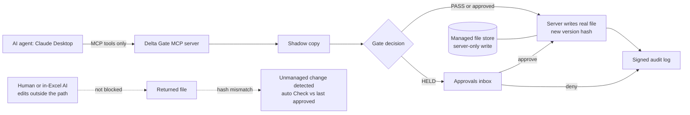
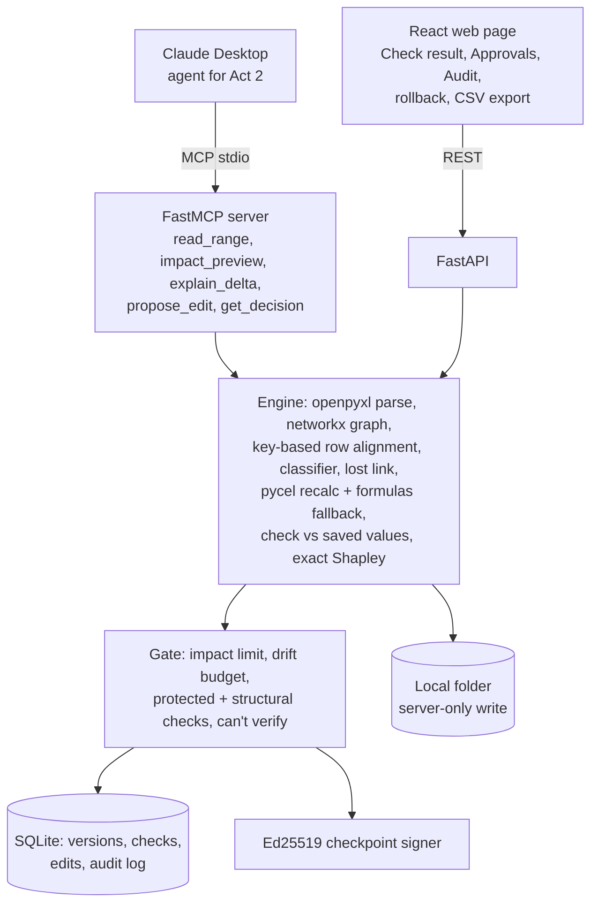

# Delta Gate: Final Project Document

**The independent check for AI spreadsheet edits.** We recalculate what every edit does, split the change exactly, and hold anything that moves your numbers or breaks your formulas. When we can't verify, we say so.
wHACKiest 2026 · Track 1: *Make MCP Matter* · Team of 4 · **Final version, 23 Nov 2026**

> **This is the single source of truth for the team.** It replaces `delta-gate-README.md`, and adds:
> - the features selected from the competitive analysis (§2.1, §2.3);
> - the competitor positioning (§2.2);
> - the updated build plan, demo and roadmap.
>
> **Supporting documents (Q&A only):**
> - `delta-gate-competitive-analysis.md`: every competitor, with sources.
> - `delta-gate-blueprint.md`: market, business model and financial *hypotheses*.

---

## 1. The problem in one stat

**84% of spreadsheets contain a material error** [Panko, via *The New Republic*, 2013](https://newrepublic.com/article/112951/kenneth-rogoff-carmen-reinhart-and-world-excel-error-research). AI agents now edit them too: Microsoft's own Excel agent completes **57.2%** of SpreadsheetBench's 912 tasks correctly [Microsoft, 2025](https://techcommunity.microsoft.com/blog/excelblog/building-agent-mode-in-excel/4457320).

When a total changes, nobody can say **which edit caused how much of the change**. Nothing checks what an AI edit does to the numbers **before** it lands.

**Root cause:** spreadsheets have no model of change. There's no record of which change caused which effect, and no check before a change takes effect. Software has diffs, tests and `terraform plan`. Spreadsheets have nothing equivalent.

**Who it's for (updated after the competitive analysis):**
- **Demo story (the regular person):** a housing-society treasurer and the society's maintenance-dues sheet. Relatable, but *not* our primary market: many societies are moving to ADDA or MyGate.
- **Primary users:** anyone **approving AI edits to sheets that matter**:
  - finance and model reviewers;
  - CA reviewers working on Excel working papers (Tally's mandatory edit log covers ledgers, not these sheets);
  - developers building spreadsheet agents over MCP.
- **Later, through partners, not as direct segments:** society platforms (ADDA, MyGate); MSMEs.

---

## 2. What it does

| Mode | Input | Output |
|---|---|---|
| **Check** | Two versions of a workbook | The change in each watched output, split exactly by cause (in ₹), data changes separated from logic changes, structural warnings, coverage %, and a **proof workbook** you can open in Excel |
| **Gate** | An AI agent's proposed edit, made through our MCP server | **PASS**, **HELD** (with reasons and impact), or **CAN'T VERIFY → HELD**; every decision written to a signed, tamper-evident log |
| **Session Audit** 🆕 | A snapshot taken *before* someone uses an AI inside Excel (Copilot, Claude for Excel), plus the file *after* | A Check of everything that AI session changed. This is our honest answer for agents we can't block (§5). |

**Three rules we never break:**
1. Every number we show is computed by the engine. The LLM only writes words, and a validator rejects any number it didn't receive from the engine.
2. If we can't verify a cell, we say so and hold. **We never guess.**
3. We only claim to *gate* writes that go through our MCP server (§5). Everything else we *detect* (Session Audit, unmanaged-change check).

### 2.1 Features added after the competitive analysis

We ran every competitor's "better than us" feature through one rule: **build what strengthens verification; integrate what others do well; partner with whoever owns the customer; skip what only an incumbent can have.** These made the cut:

| Added feature | Borrowed from | Why it earns its place | When |
|---|---|---|---|
| **`impact_preview(cell)`**: "what depends on this cell, and which watched outputs would move?" | SheetWhiz's dependents view; Claude's cell tracing | The agent (or user) checks the blast radius *before* proposing an edit, so there are fewer held edits. Nearly free, because the dependency graph already exists. | **Hackathon** |
| **Roll back to the last approved version** (approver only, *not* an agent tool) | spreadsheet-mcp checkpoints | Completes the gate story: a bad edit that slipped through can be undone in one click, and the rollback itself is logged | **Hackathon** |
| **Clickable changed cells + filter by change type** (data / logic / structural / unverified) | Claude's cell highlighting; PerfectXL's difference-type filter | Makes a long change list reviewable in seconds | **Hackathon** |
| **Change-log export (CSV)** | PerfectXL change log | What CA reviewers file as working-paper evidence | **Hackathon (cut first if late)** |
| **Session Audit mode** | — (our answer to in-Excel agents) | Turns "we can't block Copilot" into "we audit every AI session" | **Hackathon (reuses Check)** |
| **Proxy mode in front of existing Excel MCP servers** | Integration, not a copy | Popular editing servers (haris-musa, sbroenne, spreadsheet-mcp) become *gated* tools: their editing, our checks. That makes us a complement to the ecosystem, not a competitor. | **MVP** |
| **Policy-decision endpoint for agent gateways** (Gravitee, Permit.io, TrueFoundry) | Integration | They handle identity, notifications and approval UX. We answer the one question they can't: *what does this edit do to the numbers?* | **V1** |
| **Published golden-test table + open-source engine** | — (trust strategy) | Builds trust through transparency, which we can't otherwise buy | **MVP** |
| **Excel add-in running Check mode** (can't block in-Excel agents) | Tracelight and PerfectXL being inside Excel | Reaches users where they work | **V1** |
| **Row matching without a key column** | Hogandiff, xlgit (study their methods; check licences before reusing code) | Handles sheets that have no Flat No. or ID column | **MVP** |

**Deliberately *not* added:**
- **building models** (it would make us "another agent" and kill our independence);
- **company-wide spreadsheet discovery** (an enterprise EUC product);
- **society accounting** (ADDA and MyGate's job; partner instead);
- **ledger edit logs** (Tally's legal job);
- **Microsoft-level distribution** (impossible to copy).

### 2.2 Where we stand vs competitors (put this on a slide)

| | Diff two versions | Downstream impact | **Exact ₹ per change (adds up)** | **Hold AI edit by computed impact** | **Lost-link check** | **"Can't verify" instead of guessing** |
|---|---|---|---|---|---|---|
| **Delta Gate** | ✅ | ✅ | ✅ | ✅ | ✅ | ✅ |
| Tracelight ($40/mo) | ✅ | ✅ (Computed Changes + AI summary) | ❓ not documented | ❓ | ❓ | ❓ |
| Copilot in Excel (Plan mode) | ✅ (change history) | ❓ | ❓ | ⚠️ approves the *plan*, not the result | ❓ | ❓ |
| PerfectXL / Spreadsheet Compare | ✅ | ❓ | ❓ | — | ❓ | ❓ |
| spreadsheet-mcp (open source) | ✅ | ✅ (recalc + diff) | ❓ | ⚠️ staged apply, no policy | ❓ | ❓ |
| MCP approval gateways | — | — | — | ⚠️ rules on tool name/arguments, no recalculation | — | — |
| Hogandiff / xlgit (free) | ✅ | — | — | — | — | — |

*❓ means "not documented in the sources we checked", not "definitely missing". Full sources are in `delta-gate-competitive-analysis.md`.*

**One honest sentence for judges:** *"Diffing is free and approval gates are standard. We're the part in between that recalculates what an edit actually does, splits it exactly, and refuses to guess."*

### 2.3 Our tools (MCP)

| Tool | Who calls it | Purpose |
|---|---|---|
| `read_range` | Agent | Read values and formulas |
| `impact_preview` 🆕 | Agent / user | Dependents of a cell + which watched outputs it reaches |
| `explain_delta` | Agent / user | Check mode: exact ₹ split between two versions |
| `propose_edit` | Agent | The **only** write path; shadow copy → gate decision |
| `get_decision` | Agent | PASS / HELD / CAN'T VERIFY, with reasons |
| `approve` / `deny` | **Approver only** (web UI) | Commit or reject a held edit |
| `rollback` 🆕 | **Approver only** (web UI) | Restore the last approved version (logged) |
| `export_changes` 🆕 | User | CSV change log |

---

## 3. Attribution model (the maths)

### 3.1 Definitions
- **Workbook function:** `F(state)` returns the value of a watched output cell `y`, for example *Summary!C6 = Total pending dues*.
- **Base and new versions:** `B` and `N`. The total change is `Δ = F(N) − F(B)`.
- **Change groups:** the classifier groups raw cell changes into at most 8 groups `G = {g₁…gₙ}`, by block, column and type. Examples: "Payments rows 2–61 (data)", "LateFees!F3 (formula)".
- **Coalition value:** `v(S) = F(B with only the groups in S applied) − F(B)`, for any subset `S ⊆ G`. Note that `v(∅) = 0` and `v(G) = Δ`.

### 3.2 Three quantities we report for each group
| Quantity | Formula | Meaning |
|---|---|---|
| **Solo effect** | `solo(g) = v({g})` | What this change does *on its own* (this is what **Prove it** replays) |
| **Shapley share** | `φ(g) = Σ_{S ⊆ G∖{g}} [ |S|! (n−|S|−1)! / n! ] · [ v(S ∪ {g}) − v(S) ]` | Its **fair share** of the total, averaged over every order in which the changes could have been applied |
| **Interaction share** | `φ(g) − solo(g)` | The part of its share that exists only because it combines with other changes |

**Guarantees:**
- **The shares add up:** `Σ φ(g) = Δ` exactly (the *efficiency* property of Shapley values). The waterfall uses φ, so its bars always sum to the real change.
- **The interaction is not a separate leftover.** It's already spread across the φ values. We show it per group, so `solo + interaction = share`. The total interaction is `Δ − Σ solo(g)`.
- **"Unverified" is a separate bucket, not an interaction.** Cells that depend on unsupported functions are excluded from `F`. We report `Δ_verified` and `Δ_unverified = Δ_observed − Δ_verified` separately, and never blend them.

### 3.3 Worked example (verified in code)
`dues = rate × area × (1 + late%)`, with area = 1,000. **Base:** rate 3.0, late 2% → ₹3,060. **New:** rate 3.2, late 5% → ₹3,360. **Δ = ₹300.**

| Group | Solo effect | Shapley share | Interaction share |
|---|---|---|---|
| Rate 3.0 → 3.2 | ₹204 | **₹207** | +₹3 |
| Late fee 2% → 5% | ₹90 | **₹93** | +₹3 |
| **Total** | ₹294 | **₹300 = Δ ✅** | ₹6 |

*Checked by brute force: `v({rate}) = 3,264 − 3,060 = 204`; `v({late}) = 3,150 − 3,060 = 90`; `v(both) = 300`; `φ(rate) = ½·204 + ½·(300 − 90) = 207`.*

### 3.4 Cost
- **Exact Shapley on n ≤ 8 groups** means evaluating all 2ⁿ ≤ 256 coalitions.
- **Each evaluation recalculates only the cells downstream of the changed groups,** not the whole workbook.
- **More than 8 groups:** merge them hierarchically (e.g. all payment rows → one group), then let the user drill into a group.
- **Speed caveat:** pycel's author reports about 50 ms for a 10,000-formula workbook [pycel](https://github.com/stephenrauch/pycel). That's a *single* benchmark, so **we time 256 coalitions on our own demo workbook in hour 1** before promising any latency on stage.

---

## 4. Structural checks

Structural checks run on the dependency graph (`networkx`), not on numbers, so they catch breakage **even when the total doesn't move.**

| Check | Rule | Example |
|---|---|---|
| **Typed over a formula** | A cell that had a formula now holds a constant | Someone typed 1,86,000 into the Collected total |
| **Shortened range** | A range reference in a formula covers fewer rows or columns than before | `SUM(C2:C61)` → `SUM(C2:C60)`: flat 60 is missing |
| **Formula edited on a protected path** | A formula changed on the way to a watched output | Late-fee rate formula edited |
| **Rows deleted from a referenced range** | Rows removed inside a range that a formula uses | — |
| **Lost link (hackathon version)** | For each *watched output*, compare the set of **input regions** it depends on (sheet + column header) before and after. Flag any region that disappeared. | "Total dues **no longer depends on** Payments!C (Amount paid)" |

**What lost link covers, and when:**
- **Hackathon (limited, must-have):**
  - only watched outputs;
  - input regions defined as sheet + column header;
  - same-workbook references only;
  - no named ranges.
- **Roadmap, Tier 3:**
  - named ranges, cross-sheet tables and cross-file links;
  - quantifying *how much* of a region was lost;
  - "future-break test": change an input and check that the output still responds.

**Row alignment:**
- **Rows are matched on a key column** (Flat No., Invoice No.), detected from headers.
- **Fallback:** an LCS over row fingerprints that include the key and position. Without a key, two flats paying the same amount would produce identical fingerprints and get misaligned.

---

## 5. The controlled-write boundary (why the agent can't bypass the gate)

> **One line for judges:** *"The agent never holds the pen. Our MCP server is the agent's only write path to the file. Anything written outside that path shows up as an unmanaged change on the next check."*

- **File custody:** the workbook lives in the Delta Gate store (at the hackathon, a folder only the server process writes to).
- **What the agent gets:** only MCP tools: `read_range`, `impact_preview`, `explain_delta`, `propose_edit`, `get_decision`. **No file-system tool, no Excel tool.** `approve`, `deny` and `rollback` are **approver-only** and never exposed to the agent.
- **Commit path:** `propose_edit` applies the edit to a **shadow copy**, then the gate decides. Only the server writes the real file, and only after PASS or human approval. Each commit records a new version hash.
- **Out-of-band edits** (a human in Excel, Copilot inside Excel) **are not blocked; they're detected.**
  - When a file comes back, its hash is compared with the last committed hash.
  - A mismatch shows **"Unmanaged change"** and runs an automatic Check against the last approved version.
- **What we don't claim:** we don't intercept agents that run *inside* Excel. They edit the workbook directly through Excel's APIs [Microsoft, 2025](https://techcommunity.microsoft.com/blog/excelblog/building-agent-mode-in-excel/4457320). We audit their result after the fact instead, with **Session Audit**: snapshot before the AI session, Check after it.
- **Proxy mode (MVP):** Delta Gate sits between the agent and an existing Excel MCP server (haris-musa, sbroenne, spreadsheet-mcp). The agent is configured with Delta Gate only. Every write tool of the underlying server is routed through `propose_edit` and the gate first.

**Gate rules (hackathon set: three rules plus the structural checks):**
1. **Impact limit:** `|Δ output| ≤ limit` for every watched output.
2. **Cumulative drift budget:** `session drift + |Δ| ≤ budget`, so ten small edits can't slip through.
3. **Protected cells plus every structural check in §4:** any hit means HELD.
4. Plus **CAN'T VERIFY → HELD** whenever the edit touches an unsupported or volatile cell.

*Invariants (e.g. "sum of flat dues = ledger total") are a stretch goal.*

---

## 6. Verification: how we avoid "proof by our own engine"

The engine checking itself would be circular. The independent evidence comes from two things:

1. **The check against Excel's saved values (shown on screen, every time).**
   - An `.xlsx` saved by Excel contains Excel's own computed result for every formula.
   - Before trusting anything, we recalculate the **base** file and compare: *"Verified against Excel's saved values: 1,248 / 1,248 formula cells match."*
   - Any mismatch makes those cells unverifiable, and anything depending on them is held.
   - **Limitation:** files written by scripts or agents (e.g. openpyxl) have **no saved values**. For those we say so and show *"Not verifiable against Excel (no saved values)"*. We never quietly substitute our own numbers.
2. **The proof workbook (open it in real Excel).**
   - **Prove it** exports the base workbook with **only that one change applied**, formulas intact.
   - It's flagged to fully recalculate on open (`fullCalcOnLoad`, which we confirmed openpyxl supports).
   - The judge opens it in Excel or Google Sheets and sees the solo-effect number with their own eyes, computed by Excel, not by us.

---

## 7. Supported functions (published allowlist)

**How we test:**
- Golden workbooks are **authored and saved in real Excel**, so they contain Excel's results.
- CI recalculates them and compares every formula cell (tolerance 1e-9 relative).
- **A function is enabled only after it passes.** Anything else gets CAN'T VERIFY.

**Evidence collected today** (pycel 1.0b30, our own test with known answers, 23 Nov 2026):

| Status | Functions |
|---|---|
| ✅ Passed our test | SUM, MIN, MAX, AVERAGE, COUNT, IF, AND, OR, NOT, ABS, INT, MOD, SUMIF, SUMIFS, COUNTIF, SUMPRODUCT, IFERROR, VLOOKUP, INDEX, MATCH, LEN, ROUNDUP |
| ⚠️ **Fidelity risk found** | **ROUND:** `ROUND(7.5*1.234, 2)` returned **9.25** in both pycel and the `formulas` library, because in binary the product is 9.254999…. Excel is expected to return **9.26** *(confirm in real Excel)*. **Fix:** register an Excel-compatible ROUND override (round to 15 significant digits first, then decimal half-up) and add it to the golden test. Until then, ROUND is unverifiable. |
| ❌ Not implemented in pycel | **COUNTA**, **XLOOKUP**. XLOOKUP worked in the `formulas` library (fallback engine, so a candidate after golden testing); COUNTA failed there too |
| 🚫 Always unverifiable (by design) | **NOW, TODAY, RAND** (volatile: the value changes on every recalculation); **OFFSET, INDIRECT** (their references are computed at runtime, so the dependency graph can't be built statically, even though pycel implements them); macros (VBA); external links; pivot tables; dynamic arrays (FILTER, UNIQUE); LET |

**Demo workbook rule:** use only ✅ functions. Author and **save it in Excel** (or LibreOffice) in hours 0–2 so it has saved values. **Freeze it.**

---

## 8. Audit-log integrity (tamper-evident, not "tamper-proof")

A plain hash chain only proves the log hasn't changed if someone *outside our database* has kept a copy of the latest hash. So the log has three layers:

1. **Hash chain:** `hash_i = SHA-256(hash_{i−1} ‖ canonical_json(entry_i))`.
2. **Signed checkpoints:** at the end of every session and every 50 entries, the server signs `(seq, head_hash, timestamp)` with **Ed25519**. `GET /audit/verify` re-walks the chain and checks every signature.
3. **External witness:** each checkpoint's head hash goes to the approver by email, and is printed on the decision receipt and the downloadable report. If our database were rewritten, the hash the approver already holds wouldn't match.

**Roadmap:** an approver-held signing key (each approval signed on the approver's device), and **RFC 3161** timestamps from an independent timestamp authority.

**Honest claim on stage:** *"Tamper-evident with signed checkpoints and an external witness. We don't claim it's impossible to tamper with."*

---

## 9. Hackathon architecture (one complete vertical slice)

**What runs:** one machine, one process group. **No WhatsApp, no S3, no Redis, no auth service.** Those are production items on the roadmap, and WhatsApp is shown as a distribution channel on one slide.

| Layer | Hackathon choice | Production (appendix) |
|---|---|---|
| Agent surface | Claude Desktop → local FastMCP (stdio) | Remote MCP (streamable HTTP) + our own agent |
| User surface | One React page: **Check result** (waterfall, Prove it, lost-link graph, clickable cells, change-type filter, CSV export), **Approvals inbox** (approve/deny/rollback), **Audit log** | + WhatsApp, share links, Excel add-in (Check mode) |
| Integrations | None at the hackathon | Proxy in front of existing Excel MCP servers (MVP); policy-decision endpoint for gateways (V1) |
| Engine | Python: openpyxl, networkx, **pycel** (primary) + **formulas** (fallback engine) | Same, plus a LibreOffice cross-check worker |
| Storage | SQLite + local folder | Postgres + S3 (India region, 24-hour deletion) |
| Narration | Template sentences; Claude Haiku optional | Claude Haiku + number validator |

**Model IDs:**
- **Act 2 uses Claude Desktop as the agent,** so the core demo doesn't depend on our API key.
- **If we add LLM narration,** use the live API model IDs (`claude-haiku-5-5`, `claude-sonnet-5-5`).
  - Check them on hack day with the models list endpoint.
  - If the call fails, the UI falls back to template sentences, so the numbers never depend on the LLM.

---

## 10. The 3-minute demo

**Golden workbooks:** `dues_v2.xlsx` → `dues_v3_REAL.xlsx` (60 flats, sheets *Flats, Payments, LateFees, Summary*). **Planted changes in v3:**
1. New expense row "Lift repair ₹38,000" (data).
2. `LateFees!F3`: 2% → 5% (logic), +₹4,000.
3. `Summary!C4` (Collected total): the formula was replaced by its **own current value** as a typed number. The total doesn't change, but it's **no longer linked to Payments**.

| Act | Time | What the judges see |
|---|---|---|
| **0: Position** | 15 s | One slide (§2.2): *"Diffing is free, approval gates are standard. We're the part in between."* |
| **1: Check** | 60 s | Upload v2 + v3 → **+₹42,000 = ₹38,000 (new row, data) + ₹4,000 (late-fee formula, logic)**; waterfall adds up exactly. Click the ₹4,000 bar → it jumps to `LateFees!F3`; filter to "logic" changes only → **Prove it** downloads the proof workbook, opened in Excel shows +₹4,000 → **⚠️ Lost link:** "Collected no longer depends on Payments!C" with a ₹0 impact. "The number looks right, but the sheet is broken." Banner: *Verified against Excel's saved values: n/n cells* |
| **2: Gate via MCP** | 90 s | In Claude Desktop: *"Update late fees for overdue flats and tidy up the Summary sheet."* → Claude first calls **`impact_preview`** on the late-fee cell ("reaches Total pending dues") → then `propose_edit` → payment updates **PASS** → the edit to the protected late-fee formula is **HELD** → Approvals inbox shows the shadow-copy impact and waterfall → **Deny** → audit log gets a new entry and checkpoint → "Verify log ✅". Bonus: ten small edits are caught by the **drift budget**; **Rollback** restores the last approved version in one click. |
| **3: Fail closed** | 30 s | A judge drops in a sheet with XLOOKUP and a macro → e.g. *"I can verify ₹55,000 of the ₹61,000 change. The rest depends on cells using XLOOKUP or a macro (listed). Held."* (Figures illustrative; the real ones come from the file.) Present this as a feature: **"We never guess."** |

**Rehearse the judge's custom sheet:** if they bring their own file, run it live and accept a partial-coverage result.

**If asked about Copilot or Claude inside Excel:** show **Session Audit**. Take a snapshot, let the in-Excel AI edit, upload the result, and the Check runs. "We can't block them, so we audit every session."

---

## 11. 24-hour build plan (1 Dec build → 2 Dec demo)

| Hours | P1: MCP + Gate | P2: Graph + Structure | P3: Recalc + Attribution | P4: UI + Demo |
|---|---|---|---|---|
| **0–2** | FastMCP hello-world in Claude Desktop | Load the golden workbooks; key-column detection | **Smoke-test pycel on the golden workbooks + time 256 coalitions; decide fallbacks** | **Author and save the golden workbooks in Excel; freeze them** |
| 2–8 | Tools `read_range`, `propose_edit`, shadow copy | Parser, graph, classifier | Recalculation wrapper, check vs saved values | Page shell; **HELD card first** |
| 8–12 | Gate rules 1–3, SQLite | Structural checks + **lost link (limited)** + **`impact_preview`** (≈1 h, reuses the graph) | Grouping + exact Shapley + proof workbook | Check result page + waterfall + clickable cells + type filter |
| 12–16 | Approve/deny, commit path, hash chain, **rollback (≈1 h)** | Row-alignment edge cases | Cross-check with the `formulas` engine on demo cells | Approvals inbox (+ rollback button), lost-link graph (React Flow) |
| 16–18 | Ed25519 checkpoints + verify | Integration | Integration | Audit page, **CSV export**, Session Audit flow (reuses Check) |
| **18** | **Freeze.** Gate not working → demo Check + fail-closed only | | | |
| 18–24 | Rehearse the 3 acts ×3, judge-sheet drill, backup screen recording | | | |

**Cut order if time runs short:** CSV export → Session Audit screen (explain it verbally) → Ed25519 checkpoints → drift budget → lost-link graph view (keep the text alert) → rollback → Shapley (fall back to solo effects in a clearly labelled "doesn't add up exactly" mode) → gate.
**Never cut:** check vs saved values, classifier, the HELD screen.

---

## 12. Judge Q&A (one-liners)

| Question | Answer |
|---|---|
| "Can't the agent just bypass your gate?" | "The agent never holds the pen. Our MCP server is its only write path, and anything written outside it is flagged as an unmanaged change." |
| "Isn't 'Prove it' circular?" | "No. We verify against Excel's own saved values, and Prove it gives you a workbook to open in Excel yourself." |
| "Copilot shows change history." | "It shows *what* changed and *who* changed it. We show *how many rupees each change caused*, the shares add up exactly, and we hold AI edits *before* they land." |
| "Why Shapley? Isn't it overkill?" | "Changes interact. Solo effects don't add up to the total; Shapley shares do. For eight groups that's 256 recalculations." |
| "What if I use a function you don't support?" | "We tell you which cells, and we hold. We never guess." |
| "Why MCP?" | "Because the gate has to sit in the agent's write path, and any MCP agent can use the same tools." |
| "Is the log tamper-proof?" | "Tamper-evident: a hash chain, signed checkpoints, and the head hash sent to the approver." |
| "Tracelight already compares versions and shows the impact." | "It shows how changes *flow* to the outputs, with an AI summary. We give *exact ₹ per change that add up*, and we hold agent edits on that number. Its docs don't describe additive attribution." |
| "Copilot Plan mode already asks before editing." | "Plan mode approves the *intended steps*. We approve the *computed result*, including breakage that leaves the total unchanged." |
| "MCP gateways already do human approval." | "They decide on the tool name and its arguments; they can't recalculate a workbook. We're the decision they're missing, and we can plug into them." |
| "Diff tools are free." | "Agreed, so we don't compete on diffing. We start where diffs end." |
| "Societies use ADDA or MyGate." | "Many do. The society is our relatable demo; our users are people approving AI edits to sheets that matter." |
| "Isn't Shapley attribution old?" | "Yes, it's standard in finance P&L attribution. That's why we trust it. The new part is applying it to spreadsheet edits and to AI write decisions." |
| "What about Copilot inside Excel? You can't block it." | "Correct. We audit it with Session Audit: snapshot before, Check after." |

---

## 13. Roadmap (consistent with the scope above)

| Stage | Scope |
|---|---|
| **Hackathon (1–2 Dec 2026)** | The vertical slice above, **plus** `impact_preview`, rollback, clickable cells, change-type filter, CSV export and Session Audit. **Lost link is limited** to watched outputs and same-workbook column regions. 3 gate rules; signed checkpoints; published allowlist. |
| **MVP (6 weeks after)** | **Proxy mode in front of existing Excel MCP servers**; **published golden-test table + open-source engine**; row matching without a key column; Excel-compatible ROUND; more golden-tested functions; automatic output detection; pilots with 5–10 reviewers (finance/CA) and agent builders, plus a few societies for the demo story |
| **V1** | **Policy-decision endpoint for agent gateways** (Gravitee, Permit.io, TrueFoundry); **Excel add-in running Check mode**; Team features (policies, client folders, audit export); invariants; India-region storage with 24-hour deletion (DPDP); open impact-policy spec for MCP spreadsheet writes |
| **Tier 3** | **Full lost link** (named ranges, cross-sheet tables, partial loss, future-break test); XLOOKUP and more functions after golden tests; Google Sheets support |
| **Tier 4** | SDK for agent builders; approver-held keys + RFC 3161 timestamps; partner integrations (society platforms calling Check; Tally-export working papers for CA firms) |

---

## 14. Positioning in one paragraph (for the PPT and the pitch)

**Problem:** AI agents now edit the spreadsheets people run their money on, and they're often wrong. Nobody checks what an edit does to the numbers before it lands.
**Solution:** Delta Gate recalculates every edit on a copy, splits the change into exact ₹ per cause, catches broken links even when the total looks right, and holds anything that crosses your limits. When it can't verify, it says so.
**Why us:**
- diffing is free;
- approval gates are standard;
- AI summaries are guesses.

We're the independent, exact, fail-closed check in between, available to any MCP agent.

**Business model (hypotheses; see the appendix):** freemium. Pro ₹299/mo, Society ₹249/mo, Team ₹499/seat/mo; an API for agent builders. About ₹0.17 variable cost per check **[Modeled]**. Every financial figure is a hypothesis to test in pilots.
